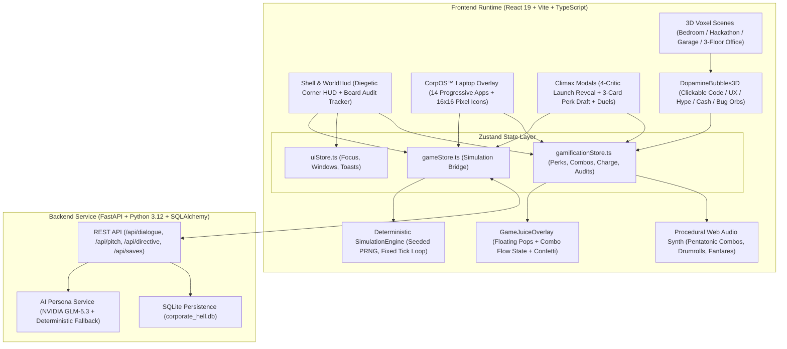

# CORPORATE HELL™: A Hybrid Diegetic 3D Corporate Simulation, Simulated Desktop OS, and Roguelite Dopamine Engine for the Web

> **Document Type:** Technical Research Paper & Iterative Engineering Progress Record  
> **Repository:** `corporate-hell` (`v1.0.0`)  
> **Stack:** React 19 · TypeScript 5.8 · Three.js / React Three Fiber · Zustand · Tailwind CSS 4 · FastAPI · SQLAlchemy · NVIDIA GLM-5.3 (with Deterministic Fallbacks) · Web Audio API

---

## Abstract

Management and business simulation games frequently suffer from a structural paradox: as systemic depth increases (engineering pipelines, cloud infrastructure, talent retention, investor negotiations, and social sentiment), the player experience degrades into passive spreadsheet maintenance and choice paralysis. **CORPORATE HELL™** investigates how a deep, deterministic startup and corporate chaos simulator can be transformed into an immediately engaging, high-retention web game without sacrificing underlying simulation fidelity.

Through six documented engineering iterations, this project evolves from a multi-tab executive dashboard into an integrated **three-layer architecture**: (1) a diegetic 3D voxel/pixel-art workplace spanning five career chapters, (2) **CorpOS™**, an in-world simulated laptop operating system with progressive app disclosure and custom 16×16 SVG pixel iconography, and (3) a **"Sweet Spot" Gamification Hybrid (`D + B + C Lite`)** combining 3D collectible dopamine bubbles, pitch-escalating combo chains, a 4-critic product launch review reveal, Balatro-inspired end-of-day roguelite perk drafts, and tactile PR bug-spotting micro-games. Deterministic unit and UI-flow test suites (30/30 passing) and zero-error TypeScript production builds validate system stability.

**Keywords:** *Game Systems Architecture, Diegetic User Interfaces, Deterministic Simulation, Roguelite Meta-Progression, React Three Fiber, Procedural Web Audio, LLM-Augmented NPCs.*

---

## 1. Introduction & Motivation

Traditional web-based tycoon simulations expose all subsystems simultaneously via permanent navigation sidebars and dense metric tables. Empirical playtesting of early builds of **CORPORATE HELL™** identified five core friction mechanisms that made gameplay feel passive and uneasy:

1. **Upfront Choice Paralysis:** Exposing 14 management apps simultaneously on Day 1 obscured the player's immediate objective.
2. **Spatial–Mechanical Disconnect:** The 3D office environment and WASD-controllable avatar functioned primarily as ambient backdrop rather than an active gameplay surface.
3. **Passive Interaction Loops:** Static multiple-choice dialogs and 1-click auto-resolvers removed tactile skill expression.
4. **Low Moment-to-Moment Feedback ("Juice"):** State mutations updated corner counters silently without spatial popups, combo escalation, particle bursts, or adaptive audio cues.
5. **Weak Session Cadence:** Absence of short-horizon milestones (e.g., 3-day audits) and end-of-day build-defining rewards reduced "one more day" replayability.

This paper documents the complete architectural design, chronological implementation progress, formal gamification mechanics, and verification results addressing each of these challenges.

---

## 2. System Architecture

**CORPORATE HELL™** separates deterministic simulation state, real-time gamification/juice state, diegetic UI focus state, 3D rendering, and optional LLM-backed narrative intelligence into loosely coupled layers.



### 2.1 Core Subsystems
| Layer | Primary Modules | Responsibility |
|---|---|---|
| **Deterministic Engine** | `frontend/src/game/engine/engine.ts`, `career.ts`, `actions.ts`, `rng.ts` | Fixed-tick (15-min/tick) corporate simulation, seeded PRNG, financials, meetings, incidents, employee AI, and 5-chapter career state machine. |
| **Gamification Engine** | `frontend/src/state/gamificationStore.ts`, `DopamineBubbles3D.tsx`, `GameJuiceOverlay.tsx` | 3D collectible bubbles, combo multiplier & decay, 0–100% Launch Charge, 14-perk roguelite catalog, 3-day Board Audits, floating combat numbers, confetti, and screen shake. |
| **3D Spatial Renderer** | `OfficeScene.tsx`, `BedroomScene.tsx`, `HackathonScene.tsx`, `GarageScene.tsx`, `PlayerAvatar.tsx`, `EmployeeCharacter.tsx` | React Three Fiber voxel scenes with autonomous animated employees, WASD player movement, camera lerping, and clickable 3D orbs. |
| **CorpOS™ Desktop** | `Laptop.tsx`, `Desktop.tsx`, `WindowManager.tsx`, `Dock.tsx`, `PixelAppIcon.tsx`, `os/apps/*` | Diegetic CRT-bezel laptop OS with draggable pixel windows, progressive day-based app unlocking, and tactile micro-games. |
| **Procedural Audio** | `frontend/src/services/audio.ts` | Zero-asset Web Audio API synthesizer for UI clicks, cash registers, bug squashes, pitch-escalating pentatonic combo chimes, drumrolls, and card draft arpeggios. |
| **AI & Persistence Backend** | `backend/app/main.py`, `ai/service.py`, `ai/personas.py`, `api/endpoints.py` | FastAPI endpoints for employee dialogue, pitch evaluation, executive directives, and save-slot persistence with deterministic offline fallbacks. |

---

## 3. Iterative Development Chronology (Progress Record)

Every major milestone recorded in the repository's history represents a deliberate architectural phase:

### Phase I — Isometric 3D World & Editorial Executive Shell
* **Recorded Commits:** `b611452`, `828b2f8`, `7b65ac2`, `aef5ed4`, `787383d`, `6908efd`
* Constructed the 3-floor 3D corporate office diorama (`OfficeFloor.tsx`), autonomous voxel characters (`EmployeeCharacter.tsx`) with distinct archetype outfits, camera floor switching (`CameraController.tsx`), and the initial 9-section executive navigation shell.

### Phase II — Deterministic Simulation Engine & AI Backend
* **Recorded Commits:** `fe5541a`, `7ab8050`, `64d57aa`, `504ab7e`
* Implemented the render-independent `SimulationEngine` with seeded PRNG (`SeededRandom`), daily financial ledgers, employee morale/stress dynamics, corporate incidents, seeded email trees, local/backend save slots, and FastAPI endpoints backed by NVIDIA GLM-5.3 with deterministic fallbacks.

### Phase III — Full Executive Simulation Suite (Sections 01–09)
* **Recorded Commits:** `2d574d4`, `2d6e655`, `e9e62c2`, `4ba3da3`, `89f4e13`, `3d17ffc`, `7fdd1f7`, `5e55390`, `44bcfd9`
* Delivered complete interactive views for Venture Pitch Boardroom, 3-Column Employee Management, Department Matrix, Finance & Cap Table Telemetry, 4-Stage Crisis Response, Executive Inbox, 6-Chapter CEO Campaign, and the Simulation Lab (what-if sliders & chaos injector), backed by 30 unit/integration tests.

### Phase IV — Software Engineering Lifecycle & CorpOS™ V2/V3 Foundation
* **Recorded Commits:** `db34874` + `CORPORATE_HELL_PIXEL_UI_REDESIGN_PLAN.md`
* Introduced the simulated developer lifecycle (`Kanban`, `GitBub`, `Pipeline`, `AWSome`, `NVIDIOT`, `Chirper`, `Launch`, `Investors`, `Pager`, `Directive.exe`, `Recruiter`, `Forge`), the 5-chapter founder career scenes (`Bedroom`, `Hackathon`, `Garage`, `Scale-Up`, `Megacorp`), pixel-art UI primitives (`PixelWindow`, `PixelBar`, `PixelButton`, `PixelToast`, `PixelIdCard`), and the `WorldHud`.

### Phase V — Addictive "Sweet Spot" Gamification Hybrid (`D + B + C Lite`)
* **Current Milestone (Committed in this release):**
  1. **3D Dopamine Loop (`D`):** Added `DopamineBubbles3D.tsx` across Bedroom, Hackathon, and Office scenes + `GameJuiceOverlay.tsx` + pitch-escalating Web Audio combo chimes (`audio.ts`).
  2. **4-Critic Product Launch Reveal (`D`):** Built `LaunchReviewModal.tsx` with customizable release names/buzzwords, timed 1–10 critic score reveals, drumroll audio, confetti bursts, and cash/hype/user surges.
  3. **Roguelite Perks & Board Audits (`B`):** Built `PerkDraftModal.tsx` (14 synergistic perks across `Common`, `Rare`, `Legendary`, and `Cursed` tiers) integrated directly into `EndOfDayModal.tsx`, plus escalating 3-day Board Audits pinned in `WorldHud.tsx`.
  4. **Tactile Micro-Game & Progressive Onboarding (`C Lite`):** Upgraded `GitbubApp.tsx` with a Tinder-style **Rapid PR Swipe** bug-spotter (`←` Reject / `→` Merge), created custom 16×16 SVG pixel icons (`PixelAppIcon.tsx`), enabled day-based progressive app unlocking on `Desktop.tsx` (with a 1-click Sandbox Unlock toggle), set V3 3D World as the default mode (`uiStore.ts`), and resolved the `[E]` key proximity-interact vs. Laptop conflict (`Shell.tsx`).

### Phase VI — Career Progression Reliability & Chapter 2 Defect Resolution
* **Current Milestone (Committed in this release):**
  * Diagnosed and fixed three bugs blocking Chapter 2 (`48-Hour Hackathon`) advancement to Chapter 3 (`The Garage`):
    1. Added immediate `evaluateChapterProgress(state)` synchronization inside `advanceCareerChapter` (`career.ts`) and all career actions (`actions.ts`) so objectives never stall while paused.
    2. Added explicit missing-goal toast diagnostics and visual button state feedback in `HackathonScene.tsx`, plus tuned prototype crunch velocity (`+24%` per 4h crunch).
    3. Repositioned the Co-Founder Talent Pool drawer (`Yuki Tanaka` / `Gary Sparks`) to eliminate HUD overlap with the left Board Audit tracker.

---

## 4. Formalized Gamification Mechanics

### 4.1 The 30-Second Core Dopamine Loop
```
Click 3D Bubble / Swipe PR  ──▶  Pitch-Escalating Combo Chime + Floating "+CODE / +$"
           │                                         │
           ▼                                         ▼
  Launch Charge (0→100%) ──▶  4-Critic Review Reveal (1–10) + Viral Cash Surge
           │                                         │
           ▼                                         ▼
  End of Day / Audit     ──▶  3-Card Roguelite Perk Draft (Stacking Multipliers)
```

### 4.2 Combo & Flow-State Multiplier Curve
Consecutive player actions within a `5.5s` rolling window increment `comboCount` and scale rewards according to a piecewise step function:

$$
M_{\text{combo}}(c) =
\begin{cases}
1.0\times & c < 2 \\
1.5\times & 2 \le c < 4 \\
2.0\times & 4 \le c < 6 \\
3.0\times & 6 \le c < 10 \quad (\text{FLOW STATE}) \\
5.0\times & c \ge 10 \quad (\text{MAX FLOW})
\end{cases}
$$

### 4.3 Product Launch Scoring & Payout Model
When **Launch Charge** reaches `100%`, four satirical tech outlets (*TechCrump*, *HackerNews*, *ProductHunt*, *The Verge-ish*) independently sample a clamped review score $S_i \in [2.0, 10.0]$:

$$
S_i = \operatorname{clamp}_{[2,10]}\!\left(\min\!\left(8.5,\; 4.5 + \frac{C + D}{90} + \frac{H}{120}\right) + \Delta_{\text{perks}} + \epsilon_i\right)
$$

where $C$ = Code points, $D$ = UX/Design points, $H$ = Hype points, $\Delta_{\text{perks}}$ = cumulative critic bonus from drafted roguelite perks, and $\epsilon_i \sim \mathcal{U}(-0.8, 1.2)$. Total launch revenue scales multiplicatively with average critic score $\bar{S}$ and active cash perk multipliers $M_{\text{cash}}$:

$$
\text{Payout} = \operatorname{round}\!\left((12000 + 120C + 100D + 140H) \cdot \frac{\bar{S}}{6.5} \cdot M_{\text{cash}}\right)
$$

### 4.4 Roguelite Perk Taxonomy (`PERK_CATALOG`)
| Rarity Tier | Count | Design Role | Representative Examples |
|---|---:|---|---|
| **Common** | 5 | Early momentum & baseline scaling | *Espresso IV Drip*, *Rubber Duck Army*, *AI Buzzword Deck* |
| **Rare** | 4 | Build-defining synergy amplifiers | *10x Unpaid Intern*, *Viral Botnet (Organic™)*, *VC FOMO Whisper Network* |
| **Legendary** | 3 | Run-breaking late-game multipliers | *Kevin's Golden Crocs*, *Black Turtleneck Aura*, *R&D Tax Credit Wizard* |
| **Cursed** | 2 | High-risk / high-reward morale tradeoffs | *Cursed: Rewrite in Rust*, *Cursed: Pizza Party Crunch* |

---

## 5. Five-Chapter Career Progression Arc

| Chapter | Environment (`Scene`) | Core Objectives | Key Mechanics Unlocked |
|---|---|---|---|
| **Ch 1** | `BedroomScene` | Master Tech (50), Ship 3 Side Projects, 300 GitHub Stars | Code Sprint minigame, 3D bubbles, CorpOS Day-1 apps |
| **Ch 2** | `HackathonScene` | Recruit 2 Co-Founders, 100% MVP Prototype, Win Pitch Duel | 48h Crunch Clock, 3-Round Venture Judge Pitch Duel |
| **Ch 3** | `GarageScene` | Split Founder Equity, Hire Early Team, Close Seed Round | Co-Founder Equity Negotiation, VC Term Sheet Duel |
| **Ch 4** | `OfficeScene` | Customize Office, Reach ARR Target, 99.5% Infra Uptime | Full 3-Floor Office, Office Builder, Cloud/GPU Clusters |
| **Ch 5** | `OfficeScene` (Megacorp) | Ring Wall Street IPO Bell, Acquire 3 Rivals, Survive Senate | Hostile M&A Takeovers, Senate Antitrust Hearing |

---

## 6. Verification & Empirical Test Results

All frontend TypeScript compilation, production bundling, and automated tests pass cleanly:

| Verification Check | Command | Result |
|---|---|---|
| **TypeScript Typecheck & Vite Bundle** | `npm --prefix frontend run build` | **Passed** (`0` TS errors, `2928` modules bundled in `4.84s`) |
| **Deterministic Engine & UI Flow Tests** | `npm --prefix frontend run test` | **Passed** (`9/9` test files, `30/30` tests in `2.58s`) |
| **Backend API & AI Fallback Tests** | `cd backend && uv run pytest -q` | Available via `npm run test:backend` |

---

## 7. Reproducibility & Local Deployment

### Prerequisites
* **Node.js** `>= 20` & **npm**
* **Python** `>= 3.12` & **uv** *(optional — required only for the FastAPI AI backend; the frontend runs fully standalone with deterministic fallbacks)*

### Installation & Run Commands
```bash
# 1. Install frontend & backend dependencies
npm run install:all

# 2. Launch Frontend + Backend concurrently (Frontend: http://localhost:5173, Backend: http://localhost:8000)
npm run dev

# Or run Frontend standalone
npm run dev:frontend

# 3. Production build & full test suite
npm run build
npm run test:frontend
```

### Controls Reference
| Input | Action |
|---|---|
| `W` `A` `S` `D` / Arrow Keys | Move 3D Voxel CEO Avatar |
| `E` | Interact with nearby 3D prop, or open/close **CorpOS™ Laptop** |
| `Tab` | Toggle In-Game Phone overlay |
| `Space` | Play / Pause simulation clock |
| `1` / `2` / `5` | Set simulation speed (`1×`, `2×`, `5×`) |
| `←` / `→` *(in GitBub Rapid Swipe)* | Reject buggy PR / Merge clean PR |
| `Esc` | Step back (close active window → close laptop → clear selection) |

---

## 8. Future Work

1. **Spatial Crisis Waves (Option A Expansion):** Add physical 3D fire/smoke states on server racks and espresso machines requiring avatar sprint-and-dash (`Shift`) interventions.
2. **CC0 Voxel/GLB Asset Pipeline:** Replace primitive `boxGeometry` office furniture with stylized low-poly `.glb` props and unified low-DPR pixel post-processing across all five chapters.
3. **Adaptive Chiptune Music Engine:** Extend `audio.ts` with a multi-layer procedural loop that dynamically adds percussion and basslines as player combo streaks enter Flow State.
4. **Prestige & Shareable Postmortem Cards:** Add an "Exit & Angel Prestige" loop with permanent meta-unlocks and exportable startup obituary scorecards.
